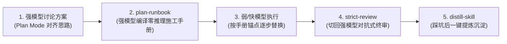

# AI Playbook Plugin

个人跨设备（公司电脑 & 家里电脑）、跨客户端通用的 AI 编码工程插件仓库。

采用单一标准的 **Claude Code Plugin（`.claude-plugin/`）** 规范组织代码，并通过 **GitHub Actions 自动递增版本号（Auto-Bump Patch Version）** 彻底解决插件更新时因 `version` 未变而卡在旧缓存的问题。

---

## 一、核心工作流：强弱模型高低配闭环

针对复杂需求或 Bug 修复，通过本插件提供的斜杠命令串起高性价比、低翻车率的研发闭环：



### 内置技能 / 斜杠命令（平时 0 Token，仅显式调用时加载）

| 技能名 | 适用模型 | 作用说明 |
| :--- | :--- | :--- |
| **`plan-runbook`** | 强模型（规划侧） | 亲自读透源码、类型与 Lint 约束，将粗粒度方案编译为包含**白名单文件、唯一 `Before/After` 完整代码锚点、异常停机准则与定向验证命令**的精确施工手册，消除弱模型自由发挥空间。 |
| **`strict-review`** | 强模型（验收侧） | 实现完成后以对抗式 Reviewer 视角对 `git diff` 与原计划逐项对账，重点排查**越界修改、遗漏分支、缓存/竞态边界、破坏上下游契约、以及“测 Mock 自嗨”的假单测**，输出精确到 `file:line` 的审查结论。 |
| **`distill-skill`** | 任意主力模型 | 在某次对话中花多轮把 AI 纠偏成功后，将实战经验按作用域分拣沉淀回本插件仓库 `skills/` 或业务仓库的 `AGENTS.md`。 |

---

## 二、在任意电脑上安装与自动同步

### 1. Claude Code + Cursor（主推：安装一次，两端生效）

在 **Claude Code** 中注册你的 GitHub 仓库为 Marketplace 并安装插件：

```text
/plugin marketplace add Mr-wang007s/ai-playbook
/plugin install ai-playbook@ai-playbook
```

**开启自动更新（首次安装后执行一次即可）**：
1. 在 Claude Code 中输入 `/plugin` $\rightarrow$ 切到 **Marketplaces** 标签页；
2. 选中 `ai-playbook` $\rightarrow$ 开启 **Enable auto-update**。
3. **Cursor 自动共享生效**：Cursor 默认开启了 `Third-Party Imports`（`Cursor Settings -> Agents -> Third-Party Imports`），会自动识别并加载本机已安装的 Claude Code 插件，无需在 Cursor 中重复安装。

> **调用方式**：在 Claude Code 中输入 `/ai-playbook:plan-runbook`、`/ai-playbook:strict-review`、`/ai-playbook:distill-skill`（输入 `/plan` 或 `/strict` 即可模糊补全）；在支持直接加载技能名的客户端中也可直接用 `/plan-runbook` 触发。

### 2. Gemini CLI / Antigravity / 其他 Agent 客户端（可选补充）

本仓库根目录下的 `skills/*/SKILL.md` 同时完全遵循开放 Agent Skills 标准，如需同步到 Gemini CLI 或 Antigravity，可直接用社区标准 CLI 按 GitHub 目录内容 Hash 安装与更新：

```bash
# 全局安装
npx skills add Mr-wang007s/ai-playbook -g

# 后续一键拉取 GitHub 最新更新
npx skills update -g
```

---

## 三、日常如何维护与迭代插件？

1. 在本地源码目录（如 `~/codespaces/ai-playbook`）修改或新增 `skills/`、`agents/`、`hooks/` 后，**无需手动修改 `.claude-plugin/plugin.json` 里的 `version`**，直接提交推送：
   ```bash
   git add -A
   git commit -m "feat(skills): refine strict-review cache key check"
   git push
   ```
2. 推送到 `main` 分支后，仓库内置的 GitHub Action（[`.github/workflows/bump-version.yml`](.github/workflows/bump-version.yml)）会自动将 `.claude-plugin/plugin.json` 的补丁版本号 `+1`（如 `1.0.0` $\rightarrow$ `1.0.1`）并带 `[skip ci]` 提交。
3. 另一台电脑启动新会话时，Claude Code 检测到新版本号即自动刷新本地插件缓存（若想在当前会话立即拉取，运行 `claude plugin marketplace update ai-playbook && claude plugin update ai-playbook@ai-playbook` 后执行 `/reload-plugins` 即可）。

### 本地校验命令

发布前可在仓库根目录使用官方 CLI 校验清单与技能 Frontmatter：

```bash
claude plugin validate .
claude plugin validate ./skills
```

---

## 四、四层经验沉淀规范

为防止把所有规则塞进全局常驻提示词导致上下文膨胀，日常经验按四层管理：

1. **L1 全局底线层（[`rules/global-coding-rules.md`](rules/global-coding-rules.md)，$\le 50$ 行）**：只放跨所有项目永远不能犯的红线（如最小改动面、延迟耗时测试至提交前）。
2. **L2 全局招式层（`skills/<name>/SKILL.md`，按需 `/` 触发，平时 0 Token）**：放跨项目通用的多步骤 SOP；详细模板拆入 `references/` 按需读取。
3. **L3 项目地图层（各业务仓库根目录 `AGENTS.md`）**：新项目可复制 [`templates/AGENTS.md.template`](templates/AGENTS.md.template)；业务仓同目录放一行 `@AGENTS.md` 的 `CLAUDE.md` 即可让三端共用同一份项目文档。
4. **L4 复利飞轮**：每次刚把 AI 从坑里拉出来时调用 `distill-skill`，趁热打铁沉淀回 L2 或 L3。

---

## 五、仓库结构

```text
ai-playbook/
├── .claude-plugin/
│   ├── plugin.json                        # 插件唯一权威清单（由 CI 自动递增 version）
│   └── marketplace.json                   # GitHub Marketplace 索引清单
├── .github/
│   └── workflows/
│       └── bump-version.yml               # Push 到 main 自动递增 patch 版本号
├── skills/                                # 核心技能与命令定义
│   ├── plan-runbook/                      # 编译弱模型零推理施工手册
│   ├── strict-review/                     # 强模型对抗式代码审查
│   └── distill-skill/                     # 实战经验分类萃取沉淀
├── rules/
│   └── global-coding-rules.md             # L1 全局底线规则参考模板
└── templates/
    └── AGENTS.md.template                 # L3 业务仓库 AGENTS.md 启动模板
```
